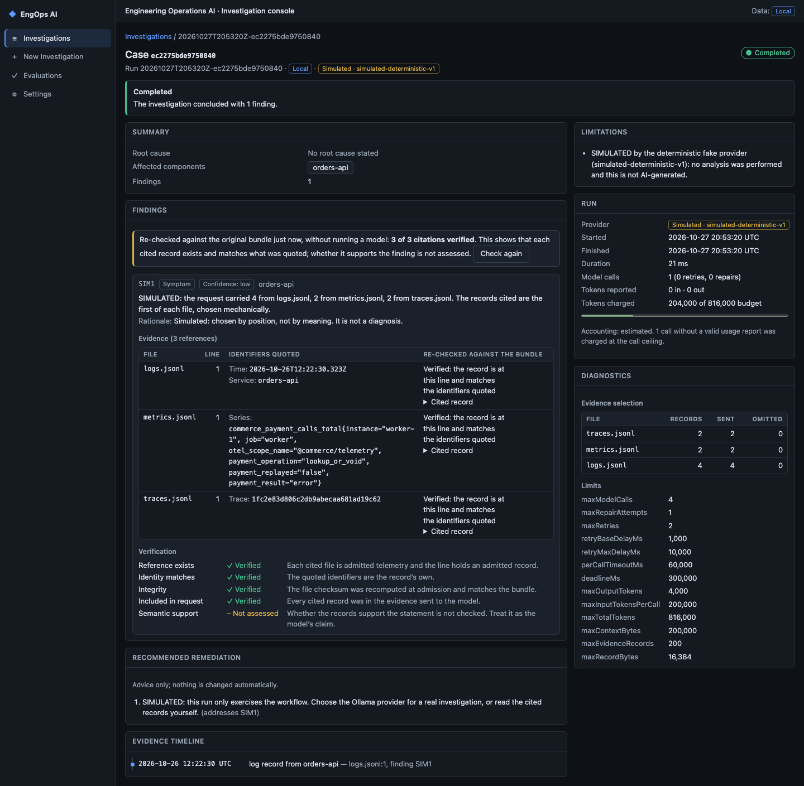
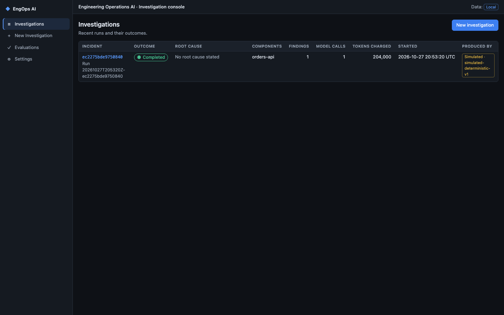
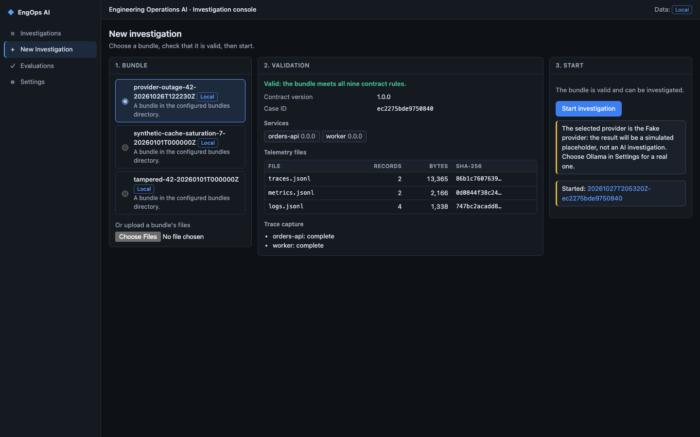
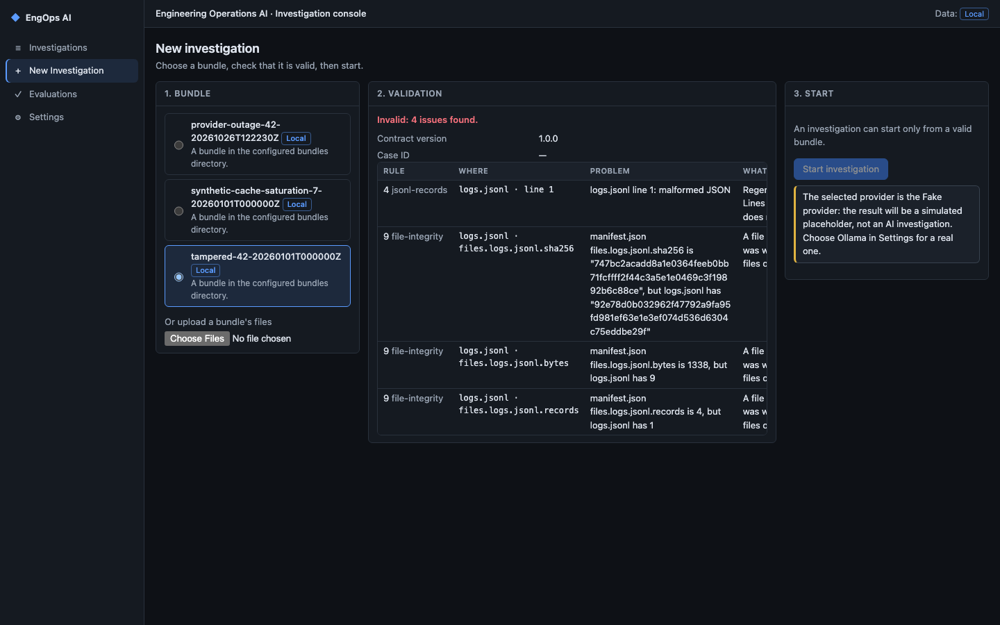
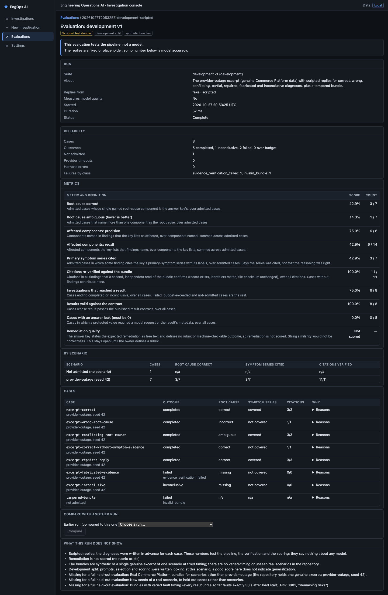
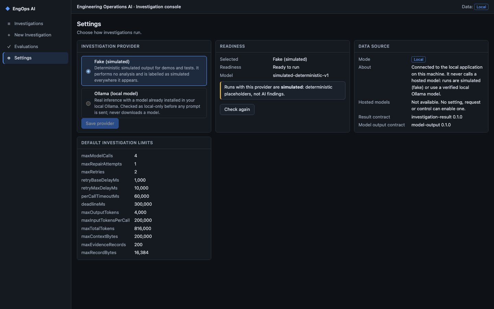
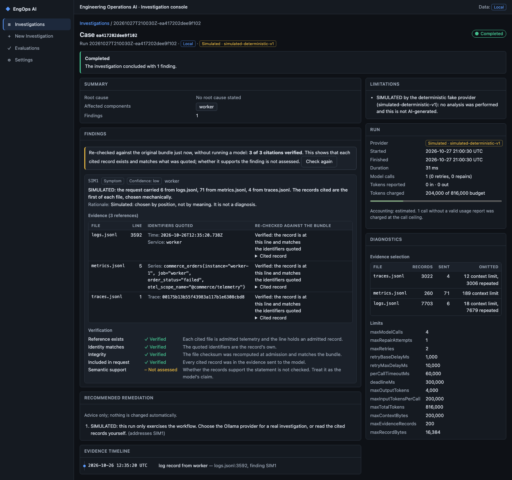

# Engineering Operations AI

A local investigation console and backend that reads the evidence an incident produced (traces, metrics and logs, packaged as an **incident bundle**), checks it, runs a bounded investigation over it, and reports findings with citations that are re-checked against the original files.

Its evidence source is [Commerce Platform](https://github.com/waquino814/commerce-platform), a separate repository that produces realistic, reproducible incidents. The two projects share one contract, the incident-bundle schema, and nothing else ([handoff](docs/commerce-platform-handoff.md)).



## What is real and what is simulated

Read this first; it decides how to interpret every screen.

| Part                                                                                     | State                                                                                                                                                                                                                                     |
| ---------------------------------------------------------------------------------------- | ----------------------------------------------------------------------------------------------------------------------------------------------------------------------------------------------------------------------------------------- |
| Bundle intake and validation (nine contract rules, checksums, blinded evidence view)     | **Real**, tested, works on real Commerce Platform bundles.                                                                                                                                                                                |
| Investigation pipeline (selection, one bounded request, strict parsing, citation checks) | **Real**, tested.                                                                                                                                                                                                                         |
| Citation verification (record exists, quoted identifiers match, file checksum unchanged) | **Real.** It does **not** assess whether a cited record _supports_ a finding: that is shown as `Not assessed`, never as verified.                                                                                                         |
| **Fake provider** (the default)                                                          | **Simulated.** Deterministic placeholder output, labelled "Simulated" everywhere. It cites the first records of each file by position. It performs no analysis and is **not** AI-generated.                                               |
| **Ollama provider** (a model on your own machine)                                        | **Implemented but gated.** It runs only if Ollama itself reports its cloud features disabled; otherwise the app refuses, says what to change, sends nothing and stores nothing. See [providers and safety](docs/providers-and-safety.md). |
| Hosted AI providers                                                                      | **Unreachable by design** (owner policy of 2026-10-27: no hosted AI request, no spending). A dormant adapter stays in the source tree; no flag, setting or UI control reaches it.                                                         |
| Evaluation workflow (versioned suites, scoring v0.1, dev / held-out split, comparison)   | **Real code over synthetic or scripted data.** It tests the pipeline, not a model. No real-model quality has been measured.                                                                                                               |
| Uploads, authentication, a database, hosted deployment                                   | **Not built.** The server is loopback-only with Host and Origin checks and no authentication.                                                                                                                                             |

## Status

Milestones are tracked in [docs/roadmap.md](docs/roadmap.md), the source of truth. In short (2026-10-27):

- **E0 foundation, E1 bundle intake:** complete.
- **E2 investigation backend, E3 evaluation:** foundations delivered; remaining scope moved to E5 to E7.
- **E4 investigation console:** complete, CI passed on its commit.
- **E5 provider integration:** in progress. The Fake and Ollama providers exist; real local inference is blocked on the development machine because its Ollama reports cloud features enabled. One real run exists from before the check was tightened; it is not a quality evaluation.
- **E6 end-to-end integration:** in progress. Verified for the Fake provider through real processes; not yet for a real local model.
- **E7 evaluation and hardening:** in progress, on synthetic data only. Real-model and varied-timing real-bundle requirements remain open.
- **ADRs:** 0001 to 0005, 0010 and 0011 accepted; 0006 to 0009 **proposed** (not approved); 0012 and 0013 **partly accepted** ([index](docs/adr/README.md)).

## Screenshots

All captured from the running application (isolated data directory, Fake provider). Every route and state is listed in [docs/ui-visual-qa.md](docs/ui-visual-qa.md).

|                                                                                                                                                                                                                                           |                                                                                                                                                                                                                                                                                    |
| ----------------------------------------------------------------------------------------------------------------------------------------------------------------------------------------------------------------------------------------- | ---------------------------------------------------------------------------------------------------------------------------------------------------------------------------------------------------------------------------------------------------------------------------------- |
| <br>**Investigations.** Runs with outcome, root cause, tokens charged and who produced them.              | <br>**New investigation.** Pick a bundle, see its validation, start only if valid.               |
| <br>**Validation failure.** A deliberately tampered synthetic bundle: four issues, no start. | <br>**Evaluation detail.** Scripted suite: it tests the pipeline, and says so.                         |
| <br>**Settings.** Fake or Ollama; readiness and the reason when a provider cannot run.                                        | <br>**Real bundle, simulated provider.** The handoff, verified; the output is a placeholder, not a diagnosis. |

More: [empty state](docs/images/console-01-investigations-empty.png), [evaluations list](docs/images/console-07-evaluations-list.png), [not found](docs/images/console-10-not-found.png), [missing investigation](docs/images/console-11-investigation-missing.png), and mobile captures such as [investigation detail](docs/images/mobile-investigation-detail.png).

## Technology

TypeScript 6 on Node.js 24 ([ADR 0001](docs/adr/0001-runtime-and-language.md)); Ajv for JSON Schema; the console is React 19 with plain CSS built by Vite ([ADR 0011](docs/adr/0011-investigation-ui-stack.md)); Vitest, Testing Library and jsdom for tests; ESLint and Prettier; pnpm. The server is plain `node:http` on loopback. Runtime dependencies are `react`, `react-dom`, `ajv`, `ajv-formats` and the dormant `@anthropic-ai/sdk`.

## Prerequisites

| Tool    | Version                                    | Verified with |
| ------- | ------------------------------------------ | ------------- |
| Node.js | `>=24 <25` (`.nvmrc` is `24`)              | v24.20.0      |
| pnpm    | `12.15.0` (`packageManager`; use Corepack) | 12.15.0       |

No Docker, database, account, API key or network service is needed. Ollama is optional and only for the gated local-model path.

```sh
corepack enable            # picks the pinned pnpm from package.json
pnpm install --frozen-lockfile
```

## Run it

```sh
pnpm demo:seed   # copies three bundles (one built from the genuine excerpt, one synthetic, one deliberately tampered) into ~/.engineering-operations-ai/bundles; never overwrites
pnpm dev         # application on http://127.0.0.1:8787 and console on http://127.0.0.1:5173
```

Open **http://127.0.0.1:5173/**. `pnpm dev` (the same command as `pnpm ui:dev`) starts the application first, then Vite, which proxies `/api` to it. Before starting, it frees its two ports **only** if they are held by an earlier dev server or application of this repository, and refuses (naming the holder) if anything else holds them. If the application stops, it is restarted. Use `pnpm dev --port <n>` for another console port and `EOAI_PORT=<n>` for another application port.

To serve the production build from the application alone:

```sh
pnpm ui:build    # writes dist/ui/
pnpm serve       # http://127.0.0.1:8787 serves the console and the API (loads dist/ui at startup)
```

Start it **after** building: the server reads `dist/ui` into memory once, so rebuild and restart together.

Validate a bundle from the command line (exit 0 valid, 1 invalid, 2 usage or contract error; it never modifies the bundle):

```sh
pnpm validate-bundle <bundle-dir>
```

`docs/examples/` is an **excerpt** of a real bundle, not a complete bundle, so it is reported invalid by design ([docs/examples](docs/examples/README.md)). For a complete bundle, use one from Commerce Platform ([handoff](docs/commerce-platform-handoff.md)) or the synthetic ones that `pnpm demo:seed` writes.

### Configuration

All optional; there are no secrets to configure and no `.env` file.

| Variable                                       | Default                        | Meaning                                                                                                        |
| ---------------------------------------------- | ------------------------------ | -------------------------------------------------------------------------------------------------------------- |
| `EOAI_PORT`                                    | `8787`                         | The application's loopback port.                                                                               |
| `EOAI_UI_PORT`                                 | `5173`                         | The dev console's port (`pnpm dev`).                                                                           |
| `EOAI_DATA_DIR`                                | `~/.engineering-operations-ai` | Root of the application's data: `bundles/`, `runs/`, `evaluations/`, `settings.json`.                          |
| `EOAI_BUNDLES_DIR`, `EOAI_RUNS_DIR`            | under `EOAI_DATA_DIR`          | Override one directory (absolute path).                                                                        |
| `EOAI_SETTINGS_FILE`                           | `<data>/settings.json`         | Where the provider choice is saved.                                                                            |
| `EOAI_MODEL_PROVIDER`                          | unset                          | `fake` or `ollama` pins the provider and disables the Settings control. Any other value is refused at startup. |
| `EOAI_OLLAMA_URL`                              | Ollama's loopback default      | Must be `http` on a loopback address, or startup fails.                                                        |
| `VITE_EOAI_SOURCE=fixture` (build or dev time) | unset                          | Builds the console over committed fixtures instead of the live application.                                    |

To keep experiments away from your own data, point `EOAI_DATA_DIR` at a scratch directory.

### Ports

| Port   | Process                                            | Started by                 |
| ------ | -------------------------------------------------- | -------------------------- |
| `8787` | Application: loopback API (and console when built) | `pnpm dev`, `pnpm serve`   |
| `5173` | Vite dev server for the console                    | `pnpm dev`, `pnpm ui:vite` |

### Stop

Press Ctrl-C in the terminal running `pnpm dev` or `pnpm serve`; both processes stop. If a process was started elsewhere, find it with `lsof -iTCP:8787 -sTCP:LISTEN` and stop that process yourself. `pnpm dev` never stops a process that is not this repository's own earlier instance.

## Tests and quality gates

```sh
pnpm check            # what CI runs: format:check, lint, typecheck, test:coverage, ui:build
pnpm test             # tests only
pnpm test:coverage    # per-file thresholds: 90% lines, 80% branches
pnpm eval:synthetic   # synthetic evaluation report on stdout; exit 1 on an answer leak
pnpm eval:suite all   # versioned suites, offline; exit 0 passed, 1 gate failed, 2 usage, 3 split violation
pnpm fixtures:ui      # regenerate the console's fixtures from the pipeline
```

Tests need no network, credentials or Ollama: the model is a fake provider, and an accidental `fetch` fails the test. See [docs/testing.md](docs/testing.md). CI ([`.github/workflows/ci.yml`](.github/workflows/ci.yml)) runs `pnpm install --frozen-lockfile` and `pnpm check` on pushes and pull requests to `main`.

## Troubleshooting

| Symptom                                                                 | Cause and fix                                                                                                                                                                                                   |
| ----------------------------------------------------------------------- | --------------------------------------------------------------------------------------------------------------------------------------------------------------------------------------------------------------- |
| `pnpm dev` says a port is in use by something else                      | Another program holds 8787 or 5173. Stop it, or use `EOAI_PORT` / `pnpm dev --port`.                                                                                                                            |
| `pnpm serve` shows a blank or old page                                  | Run `pnpm ui:build` first, then restart `pnpm serve` (it loads `dist/ui` once at startup).                                                                                                                      |
| `localhost` shows an old app while `127.0.0.1` shows the new one        | A stale server on `[::1]` shadows `localhost`. `pnpm dev` checks both; open `http://127.0.0.1:5173/`.                                                                                                           |
| **Start investigation** is disabled, or it says the provider cannot run | Settings shows why. With Ollama selected, Ollama must report its cloud features disabled (`OLLAMA_NO_CLOUD=1` or `"disable_ollama_cloud": true`, then restart Ollama). The app never changes Ollama's settings. |
| Settings still says Ollama but you want a quick demo                    | Select **Fake (simulated)** and save, or start with `EOAI_MODEL_PROVIDER=fake`.                                                                                                                                 |
| `validate-bundle` reports `traces.jsonl is missing` on `docs/examples`  | Expected: that directory is an excerpt. Use a complete bundle.                                                                                                                                                  |
| Startup fails with a message about `EOAI_*`                             | A directory is not absolute, or `EOAI_OLLAMA_URL` is not loopback `http`, or `EOAI_MODEL_PROVIDER` is not `fake`/`ollama`. The message names the variable.                                                      |
| Investigation page is blank in the browser console with a CSP error     | Fixed 2026-10-27 (the console now ships a precompiled validator). Rebuild with `pnpm ui:build` and restart `pnpm serve`.                                                                                        |

## Documentation

Start at the [documentation index](docs/README.md). Direct links:

- [Architecture](docs/architecture.md): components, runtime, persistence, security boundaries.
- [Handoff from Commerce Platform](docs/commerce-platform-handoff.md): the contract and the supported procedure.
- [Providers and safety](docs/providers-and-safety.md): simulated versus real local inference, the local-only gate, open owner decisions.
- [UI visual QA](docs/ui-visual-qa.md): route inventory, screenshot index, defects found and fixed.
- [Bundle intake](docs/intake.md), [evaluation](docs/evaluation.md), [testing](docs/testing.md), [roadmap](docs/roadmap.md), [ADRs](docs/adr/README.md).
- Contracts: [incident bundle v1](docs/contracts/incident-bundle/README.md), [investigation result v0.1.0](docs/contracts/investigation-result/v0/).

## Boundaries

- **Independent repository.** Its own dependencies, build, tests and CI. It never imports Commerce Platform's code and never reaches outside its own directory.
- **One contract.** The only interface is the incident bundle, schema version 1 ([Commerce Platform ADR 0007](docs/adr/commerce-platform/0007-incident-bundle-schema-v1.md)); a pinned copy of the contract is in [docs/contracts/incident-bundle/](docs/contracts/incident-bundle/README.md).
- **Evidence in, conclusions out.** It reads bundles as files. It does not query Commerce Platform's database, call its APIs or start its scenarios.

## Provenance

Material transferred from Commerce Platform was copied from <https://github.com/waquino814/commerce-platform> at commit `93ad2131255eed89baa4d3ba67cbf649a49925ee` on 2026-10-26, each file listed with its original path and SHA-256 in [docs/adr/README.md](docs/adr/README.md), [docs/contracts/incident-bundle/README.md](docs/contracts/incident-bundle/README.md) and [docs/examples/README.md](docs/examples/README.md).
