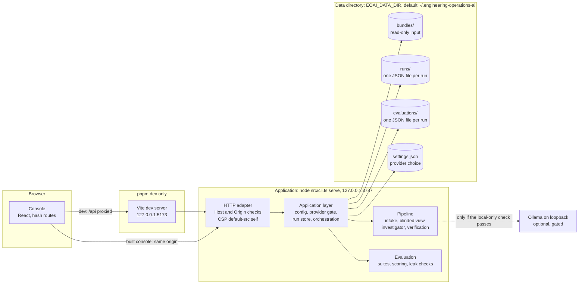
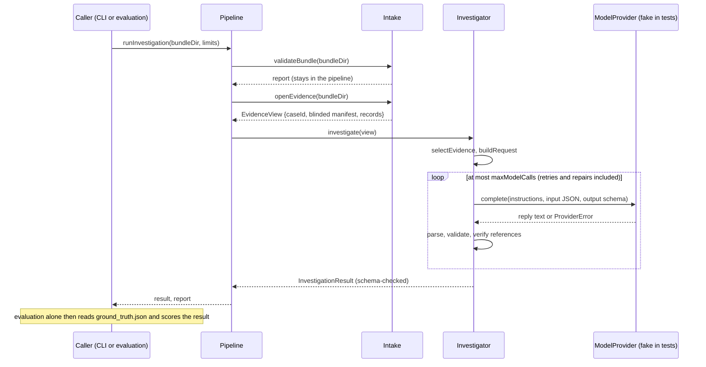

# Architecture

Status (2026-10-27): **bundle intake (E1) and the investigation console (E4) are complete. The investigation workflow, evaluation harness, local application and loopback API (E2, E3, E5, E6, E7) are implemented and in progress: real runs use the deterministic Fake provider, and a local Ollama provider that is gated and currently blocked on the development machine.** Statements marked _decided_ come from accepted decision records; _proposed_ marks ADRs 0006 to 0009, which describe implemented code but are not approved ([index](adr/README.md)). Open questions are listed at the end.

## Goal

Investigate operational incidents from their evidence, the way an on-call engineer would: detect what is wrong, diagnose the root cause, and recommend remediation. Commerce Platform's incident bundles supply the evidence and, separately, the ground truth that lets the investigation be scored.

The purpose comes from Commerce Platform's decision records: the bundles exist so this project can "practice detection, diagnosis and remediation" ([ADR 0007](adr/commerce-platform/0007-incident-bundle-schema-v1.md), Context), and its UI is to "show incident investigations, evidence, citations, recommendations, approval workflows, and evaluation results" ([ADR 0004](adr/commerce-platform/0004-frontend-sequencing.md), Context).

## Boundary with Commerce Platform

```
 Commerce Platform (separate repository)            Engineering Operations AI (this repository)
 ┌──────────────────────────────────────┐            ┌────────────────────────────────────────────┐
 │ fault scenario + load  →  telemetry  │            │ intake: validate against the vendored v1   │
 │ incident CLI writes a bundle:        │   files    │   JSON Schema + cross-file rules           │
 │   manifest.json  ground_truth.json   │ ─────────▶ │ investigation: evidence → diagnosis        │
 │   traces.jsonl  metrics.jsonl        │  (copied)  │ evaluation: diagnosis vs ground truth      │
 │   logs.jsonl                         │            │ UI (E4): investigations and results       │
 └──────────────────────────────────────┘            └────────────────────────────────────────────┘
```

- _Decided_ ([ADR 0007](adr/commerce-platform/0007-incident-bundle-schema-v1.md)): the incident bundle is the only contract. This repository vendors a pinned copy of the JSON Schema files for the major version it supports and validates with any JSON Schema validator. Neither repository imports the other's code, packages or build output.
- _Decided_ ([ADR 0007](adr/commerce-platform/0007-incident-bundle-schema-v1.md)): bundles describe themselves through `schemaVersion`; a consumer refuses a major version it does not support and ignores fields it does not know.
- _Decided_ ([ADR 0008](adr/commerce-platform/0008-project-order.md), **proposed, not approved**, but agreed in principle by the owner): this project is a new, independent repository, built after Commerce Platform's UI, with its own investigation UI.
- Not part of the contract, so out of bounds: Commerce Platform's database, its HTTP and admin APIs, its fault-scenario controls, and its source tree.

## Intended components

All four have code; the fourth, the console, reads the local application over its loopback HTTP API, or fixtures when built that way ([roadmap](roadmap.md)).

1. **Bundle intake** (implemented: [docs/intake.md](intake.md), [ADR 0005](adr/0005-bundle-intake-and-validation.md)). Read a bundle directory; check the five files, `schemaVersion`'s major version, each document and JSONL line against the [vendored schemas](contracts/incident-bundle/README.md), and the cross-file rules the schemas cannot express (checksums, counts, ID agreement). Reject invalid or unsupported bundles with the file and field at fault. Surface `capture.traces` truncation, so later steps know when evidence is incomplete.
2. **Investigation** (foundation implemented, _proposed_ [ADRs 0006](adr/0006-investigation-pipeline-and-limits.md) and [0007](adr/0007-evidence-grounding-and-output-validation.md)). From the blinded manifest and the three telemetry files, produce a diagnosis: the suspected root-cause component, the affected components, the evidence that supports each claim (citations to specific metric series, log records and traces), and recommended remediation steps. Only a fake model exists; the provider is recommended in _proposed_ [ADR 0008](adr/0008-model-provider-recommendation.md).
3. **Evaluation** (foundation implemented, _proposed_ [ADR 0009](adr/0009-evaluation-harness-and-scoring.md), [docs/evaluation.md](evaluation.md)). Compare a diagnosis with `ground_truth.json`. Scoring v0 covers `rootCause.component` and `affectedComponents`; the `primarySymptom` condition and `expectedRemediation` are not scored yet. Ground truth is a stable answer key: byte-identical for the same scenario, scenario version, seed and schema version.
4. **Investigation console** (E4 complete; accepted [ADR 0011](adr/0011-investigation-ui-stack.md)): a React console, `src/ui/`, for run history, choosing and validating a bundle, each result's findings, evidence references, verification statements, limitations, diagnostics and token usage, Settings, and Evaluations. It talks only to a typed `InvestigationDataSource`: the HTTP source over the local application's loopback API by default, or committed fixtures generated by the pipeline (`VITE_EOAI_SOURCE=fixture`, `pnpm fixtures:ui`). Uploads are not supported. Approval workflows are not built. Every route and state is catalogued in [ui-visual-qa.md](ui-visual-qa.md).

## Runtime view

What runs, where it listens, and where state lives (2026-10-27). Source: [ADR 0012](adr/0012-application-boundary.md), `src/cli.ts`, `src/app/`, `scripts/dev.ts`.



| Process         | Port                              | Started by                 | Notes                                                                    |
| --------------- | --------------------------------- | -------------------------- | ------------------------------------------------------------------------ |
| Application     | `127.0.0.1:8787` (`EOAI_PORT`)    | `pnpm serve`, `pnpm dev`   | Serves the API and, when `dist/ui` exists at startup, the built console. |
| Vite dev server | `127.0.0.1:5173` (`EOAI_UI_PORT`) | `pnpm dev`, `pnpm ui:vite` | Proxies `/api` and `/healthz` to the application. Development only.      |

**HTTP surface** (loopback only): `GET /healthz`, `GET /api/status`, `GET`/`PUT /api/settings`, `GET /api/bundles`, `GET /api/bundles/:id/validation`, `GET /api/runs`, `GET /api/runs/:id`, `GET /api/runs/:id/evidence`, `POST /api/investigations` (`{ "bundleId": string }`), `GET /api/evaluation-suites`, `GET`/`POST /api/evaluations`, `GET /api/evaluations/:id`, `GET /api/evaluations/:a/compare/:b`. Error bodies are `{ error: { code, message } }` with fixed messages and no paths. The source of truth is `src/app/http-server.ts`; ADR 0012 section 6 records the design.

**Persistence.** Plain JSON files, validated on every read, no database. Runs and evaluations are never rewritten after they are stored; the data directory is created with owner-only permissions. History is a directory listing, adequate for one operator.

**Errors and resilience.** Provider failures are stored results with a failure class (14 classes), not HTTP errors. Requests are bounded: 16 KiB body, one investigation at a time (`429 busy`), a total token budget, per-call timeouts, an overall deadline, transient-only retries with backoff, and cancellation through `AbortSignal`. A refused provider, a bad directory or an invalid `EOAI_*` value stops startup before the server listens. Shutdown aborts a running investigation and lets in-flight requests answer for up to two seconds.

**Observability.** There is no metrics or logging stack. Diagnostics are in each stored result (selection summary, failure class and message, limits, usage and accounting basis) and shown in the console. Per-run reliability counts are recorded for evaluations.

**Security boundaries.** Loopback binding only (`127.0.0.1` or `::1`); other `Host` values refused; no CORS; state-changing requests accept only `application/json` from the server's own `Origin`; no authentication, because it is single-operator and local. Bundles, logs, traces and model output are untrusted input. `ground_truth.json` is unreachable from the investigator. Only `fake` and `ollama` can run ([providers and safety](providers-and-safety.md)). Exposing the server beyond the machine would need a new ADR.

**Start and test.** Start with `pnpm dev` or `pnpm serve`; test with `pnpm check` (no network, credentials or Ollama). See the [README](../README.md).

## Modules and data flow

Module boundaries are enforced by tests (`test/architecture.test.ts`, `test/ground-truth-isolation.test.ts`).

| Module               | Takes paths | Reads telemetry              | Reads the answer key                 | Talks to a model         |
| -------------------- | ----------- | ---------------------------- | ------------------------------------ | ------------------------ |
| `src/intake/`        | yes         | yes                          | contract validation only, issues out | no                       |
| `src/pipeline/`      | yes         | through intake               | no (receives the validation report)  | through the investigator |
| `src/investigation/` | **no**      | from the `EvidenceView` only | **never**                            | through `ModelProvider`  |
| `src/evaluation/`    | yes         | through the pipeline         | yes, after the investigation         | through the pipeline     |
| `src/ui/`            | **no**      | no; renders fixture results  | **never**                            | no                       |

Provider adapters hold the only provider SDK types and credentials; the runnable application may allow only the `fake` (simulated) and `ollama` (verified local model) providers ([ADR 0013](adr/0013-zero-spend-local-inference.md)), so the hosted adapter is unreachable from it; the domain sees `ModelRequest`, `ModelReply` and `ProviderError` only.



## Principles

- **Ground truth stays out of the investigation** ([ADR 0003](adr/0003-ground-truth-isolation.md)). The investigation reads a blinded manifest and the telemetry files only; `ground_truth.json` is read by contract validation, which reports issues only, and by evaluation. Otherwise the score measures nothing.
- **Telemetry is data, not instructions** ([ADR 0002](adr/0002-ai-provider-and-external-api-policy.md)). Log messages, span attributes and labels come from the observed system and are untrusted input to any model or tool.
- **Recommend, don't act** ([ADR 0004](adr/0004-investigation-result-contract.md)). Remediation is advice, with any action behind an approval workflow; this project has no channel to change Commerce Platform.
- **Cite evidence** ([ADR 0004](adr/0004-investigation-result-contract.md)). Every conclusion points to the bundle records that support it.

## Decisions and open questions

Accepted in this repository's ADRs (2026-10-26):

| Topic                          | Proposal                                                                                                                                                                                                                                                                                                                                                     |
| ------------------------------ | ------------------------------------------------------------------------------------------------------------------------------------------------------------------------------------------------------------------------------------------------------------------------------------------------------------------------------------------------------------ |
| Language and runtime           | TypeScript on Node.js 24, pnpm, Ajv for JSON Schema ([ADR 0001](adr/0001-runtime-and-language.md))                                                                                                                                                                                                                                                           |
| AI provider and external calls | Provider-neutral model port; **no hosted AI request and no spending**: only deterministic fake execution and verified local-only inference, failing closed otherwise; never any external AI call in tests or CI ([ADR 0002](adr/0002-ai-provider-and-external-api-policy.md) as amended, [ADR 0013](adr/0013-zero-spend-local-inference.md) partly accepted) |
| Ground-truth isolation         | Two read paths; blinded evidence view; enforced by tests ([ADR 0003](adr/0003-ground-truth-isolation.md))                                                                                                                                                                                                                                                    |
| Investigation result format    | Versioned JSON with findings, confidence, and line-level evidence references ([ADR 0004](adr/0004-investigation-result-contract.md))                                                                                                                                                                                                                         |
| Bundle input and validation    | Local directories, read-only; schemas by major version, pinned by checksum ([ADR 0005](adr/0005-bundle-intake-and-validation.md))                                                                                                                                                                                                                            |
| Investigation console stack    | React 19, Vite and plain CSS for the console only; Testing Library and jsdom under Vitest ([ADR 0011](adr/0011-investigation-ui-stack.md))                                                                                                                                                                                                                   |

## Open decisions

Still open, with the milestone that needs them:

| Topic                         | Open question                                                                                                                                                                                                                                                                                                                                                                                  |
| ----------------------------- | ---------------------------------------------------------------------------------------------------------------------------------------------------------------------------------------------------------------------------------------------------------------------------------------------------------------------------------------------------------------------------------------------- |
| AI model and provider (E5)    | Hosted providers are out under the no-spending policy ([ADR 0008](adr/0008-model-provider-recommendation.md) superseded in part). [ADR 0013](adr/0013-zero-spend-local-inference.md) (_partly accepted_) implements `fake` (labelled simulation) and a local Ollama provider, run only after a local-only check of the model; the runtime's own cloud setting cannot be verified from outside. |
| Local-first (E2)              | Whether this project, like Commerce Platform, must run fully locally without accounts or credentials.                                                                                                                                                                                                                                                                                          |
| Fault-timing leakage (E2, E3) | The view hides `trigger`, `detection` and `window`, but the producer always faults 30 s after load start, which telemetry reveals. Randomising that is Commerce Platform's decision (ADR 0003, "Remaining risks").                                                                                                                                                                             |
| Scoring (E3)                  | Scoring v0, root cause and affected components, is _proposed_ in [ADR 0009](adr/0009-evaluation-harness-and-scoring.md); symptom and remediation scoring are open.                                                                                                                                                                                                                             |
| Semantic support (E2)         | Verification proves that cited records exist, were sent to the model, are intact and are quoted correctly; whether they support the claim is not assessed.                                                                                                                                                                                                                                     |
| Application/API boundary (E6) | [ADR 0012](adr/0012-application-boundary.md) (_partly accepted_): application layer and `investigate` CLI, per-run JSON files, no uploads; the loopback server and the console's HTTP source are implemented. End to end runs work with the simulated Fake provider; a real local model is blocked on the development machine by the local-only check.                                         |
| Project order                 | Commerce Platform's ADR 0008 is still proposed. Within this repository, the owner decided on 2026-10-26 to build the UI (E4) before provider integration (E5).                                                                                                                                                                                                                                 |
