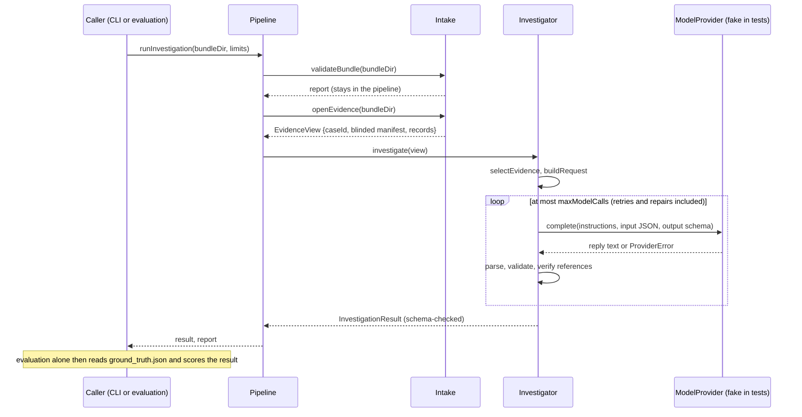

# Architecture

Status: **bundle intake is implemented (E1); the investigation workflow and evaluation harness are implemented as a foundation (E2/E3), with a fake model only.** Statements marked _decided_ come from accepted decision records; _proposed_ marks ADRs 0006 to 0009, which describe implemented code but are not approved ([index](adr/README.md)). Open questions are listed at the end.

## Goal

Investigate operational incidents from their evidence, the way an on-call engineer would: detect what is wrong, diagnose the root cause, and recommend remediation. Commerce Platform's incident bundles supply the evidence and, separately, the ground truth that lets the investigation be scored.

The purpose comes from Commerce Platform's decision records: the bundles exist so this project can "practice detection, diagnosis and remediation" ([ADR 0007](adr/commerce-platform/0007-incident-bundle-schema-v1.md), Context), and its UI is to "show incident investigations, evidence, citations, recommendations, approval workflows, and evaluation results" ([ADR 0004](adr/commerce-platform/0004-frontend-sequencing.md), Context).

## Boundary with Commerce Platform

```
 Commerce Platform (separate repository)            Engineering Operations AI (this repository)
 ┌──────────────────────────────────────┐            ┌────────────────────────────────────────────┐
 │ fault scenario + load  →  telemetry  │            │ intake: validate against the vendored v1   │
 │ incident CLI writes a bundle:        │   files    │   JSON Schema + cross-file rules           │
 │   manifest.json  ground_truth.json   │ ─────────▶ │ investigation: evidence → diagnosis        │
 │   traces.jsonl  metrics.jsonl        │  (copied)  │ evaluation: diagnosis vs ground truth      │
 │   logs.jsonl                         │            │ UI (later): investigations and results     │
 └──────────────────────────────────────┘            └────────────────────────────────────────────┘
```

- _Decided_ ([ADR 0007](adr/commerce-platform/0007-incident-bundle-schema-v1.md)): the incident bundle is the only contract. This repository vendors a pinned copy of the JSON Schema files for the major version it supports and validates with any JSON Schema validator. Neither repository imports the other's code, packages or build output.
- _Decided_ ([ADR 0007](adr/commerce-platform/0007-incident-bundle-schema-v1.md)): bundles describe themselves through `schemaVersion`; a consumer refuses a major version it does not support and ignores fields it does not know.
- _Decided_ ([ADR 0008](adr/commerce-platform/0008-project-order.md), **proposed, not approved**, but agreed in principle by the owner): this project is a new, independent repository, built after Commerce Platform's UI, with its own investigation UI.
- Not part of the contract, so out of bounds: Commerce Platform's database, its HTTP and admin APIs, its fault-scenario controls, and its source tree.

## Intended components

The first three have code; the fourth does not.

1. **Bundle intake** (implemented: [docs/intake.md](intake.md), [ADR 0005](adr/0005-bundle-intake-and-validation.md)). Read a bundle directory; check the five files, `schemaVersion`'s major version, each document and JSONL line against the [vendored schemas](contracts/incident-bundle/README.md), and the cross-file rules the schemas cannot express (checksums, counts, ID agreement). Reject invalid or unsupported bundles with the file and field at fault. Surface `capture.traces` truncation, so later steps know when evidence is incomplete.
2. **Investigation** (foundation implemented, _proposed_ [ADRs 0006](adr/0006-investigation-pipeline-and-limits.md) and [0007](adr/0007-evidence-grounding-and-output-validation.md)). From the blinded manifest and the three telemetry files, produce a diagnosis: the suspected root-cause component, the affected components, the evidence that supports each claim (citations to specific metric series, log records and traces), and recommended remediation steps. Only a fake model exists; the provider is recommended in _proposed_ [ADR 0008](adr/0008-model-provider-recommendation.md).
3. **Evaluation** (foundation implemented, _proposed_ [ADR 0009](adr/0009-evaluation-harness-and-scoring.md), [docs/evaluation.md](evaluation.md)). Compare a diagnosis with `ground_truth.json`. Scoring v0 covers `rootCause.component` and `affectedComponents`; the `primarySymptom` condition and `expectedRemediation` are not scored yet. Ground truth is a stable answer key: byte-identical for the same scenario, scenario version, seed and schema version.
4. **Investigation UI** (after the backend): investigations, evidence, citations, recommendations, approval workflows and evaluation results, per ADR 0004.

## Modules and data flow

Module boundaries are enforced by tests (`test/architecture.test.ts`, `test/ground-truth-isolation.test.ts`).

| Module               | Takes paths | Reads telemetry              | Reads the answer key                 | Talks to a model         |
| -------------------- | ----------- | ---------------------------- | ------------------------------------ | ------------------------ |
| `src/intake/`        | yes         | yes                          | contract validation only, issues out | no                       |
| `src/pipeline/`      | yes         | through intake               | no (receives the validation report)  | through the investigator |
| `src/investigation/` | **no**      | from the `EvidenceView` only | **never**                            | through `ModelProvider`  |
| `src/evaluation/`    | yes         | through the pipeline         | yes, after the investigation         | through the pipeline     |

Provider adapters, when one exists, hold the only provider SDK types and credentials; the domain sees `ModelRequest`, `ModelReply` and `ProviderError` only.



## Principles

- **Ground truth stays out of the investigation** ([ADR 0003](adr/0003-ground-truth-isolation.md)). The investigation reads a blinded manifest and the telemetry files only; `ground_truth.json` is read by contract validation, which reports issues only, and by evaluation. Otherwise the score measures nothing.
- **Telemetry is data, not instructions** ([ADR 0002](adr/0002-ai-provider-and-external-api-policy.md)). Log messages, span attributes and labels come from the observed system and are untrusted input to any model or tool.
- **Recommend, don't act** ([ADR 0004](adr/0004-investigation-result-contract.md)). Remediation is advice, with any action behind an approval workflow; this project has no channel to change Commerce Platform.
- **Cite evidence** ([ADR 0004](adr/0004-investigation-result-contract.md)). Every conclusion points to the bundle records that support it.

## Decisions and open questions

Accepted in this repository's ADRs (2026-10-26):

| Topic                          | Proposal                                                                                                                                                                           |
| ------------------------------ | ---------------------------------------------------------------------------------------------------------------------------------------------------------------------------------- |
| Language and runtime           | TypeScript on Node.js 24, pnpm, Ajv for JSON Schema ([ADR 0001](adr/0001-runtime-and-language.md))                                                                                 |
| AI provider and external calls | Provider-neutral model port; external calls only when explicitly configured, never in tests or CI, with hard budgets ([ADR 0002](adr/0002-ai-provider-and-external-api-policy.md)) |
| Ground-truth isolation         | Two read paths; blinded evidence view; enforced by tests ([ADR 0003](adr/0003-ground-truth-isolation.md))                                                                          |
| Investigation result format    | Versioned JSON with findings, confidence, and line-level evidence references ([ADR 0004](adr/0004-investigation-result-contract.md))                                               |
| Bundle input and validation    | Local directories, read-only; schemas by major version, pinned by checksum ([ADR 0005](adr/0005-bundle-intake-and-validation.md))                                                  |

## Open decisions

Still open, with the milestone that needs them:

| Topic                         | Open question                                                                                                                                                                                                      |
| ----------------------------- | ------------------------------------------------------------------------------------------------------------------------------------------------------------------------------------------------------------------ |
| AI model and provider (E2)    | ADR 0002 sets the policy. [ADR 0008](adr/0008-model-provider-recommendation.md) (_proposed_) recommends a Claude API adapter; nothing is integrated or measured.                                                   |
| Local-first (E2)              | Whether this project, like Commerce Platform, must run fully locally without accounts or credentials.                                                                                                              |
| Fault-timing leakage (E2, E3) | The view hides `trigger`, `detection` and `window`, but the producer always faults 30 s after load start, which telemetry reveals. Randomising that is Commerce Platform's decision (ADR 0003, "Remaining risks"). |
| Scoring (E3)                  | Scoring v0, root cause and affected components, is _proposed_ in [ADR 0009](adr/0009-evaluation-harness-and-scoring.md); symptom and remediation scoring are open.                                                 |
| Result contract amendment     | [ADR 0010](adr/0010-investigation-result-contract-v0.md) (_proposed_): no `failure` on `inconclusive` (incompatible with ADR 0004's text), plus additive `verification`, `selection` and token fields.             |
| Semantic support (E2)         | Verification proves that cited records exist, were sent to the model, are intact and are quoted correctly; whether they support the claim is not assessed.                                                         |
| Investigation UI stack (E4)   | Not specified; decided when the UI milestone starts.                                                                                                                                                               |
| Project order                 | Commerce Platform's ADR 0008 is still proposed.                                                                                                                                                                    |
